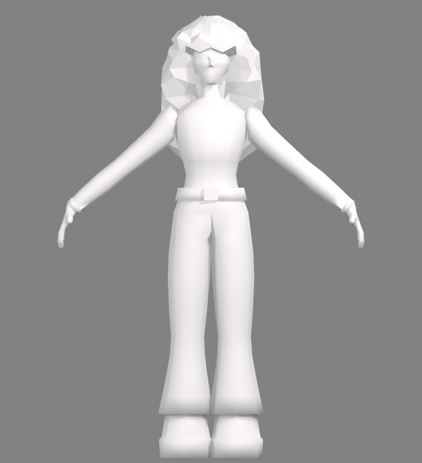
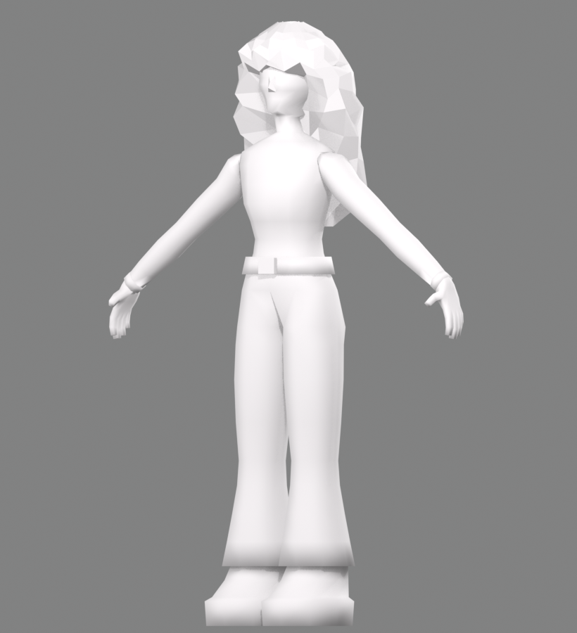
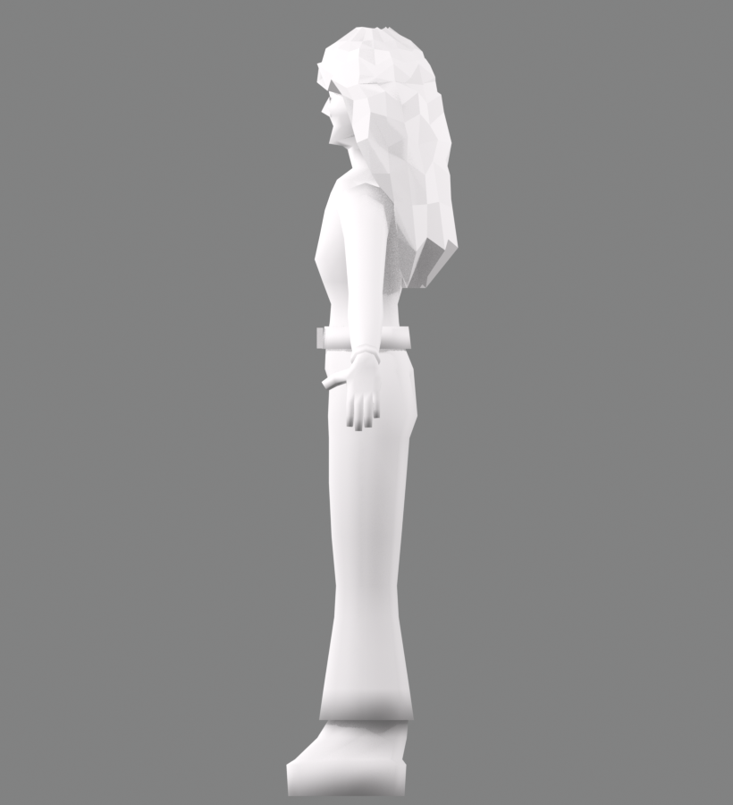
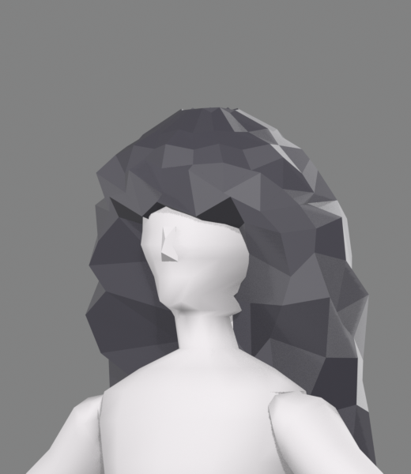
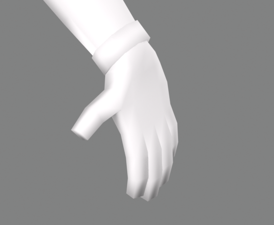

# Low-Poly-Modeling-Skill

A skill for AI coding agents that model **PS1/PSX-style low-poly assets in Blender**.

Not a modeling tutorial. It is the working method that converges fast: block with lofts,
judge in clay, correct numbers instead of vertices, weld the joints into one surface, and
verify with the same gate every time. It also carries the list of failure modes that cost
the most round trips, so the next attempt doesn't rediscover them.

The body doctrine is **one welded surface**: limbs grow out of the torso through cut
sockets and shared rings, not pushed into it and hidden under a garment. Butted shells are
a blockout stage, not a result — they show a seam in close-up and tear when rigged.

Built from a study of five real PS1-era and retro-style reference models and one finished
character.

## What's here

| file | what it is |
|---|---|
| `SKILL.md` | the skill: conventions, API, welding doctrine, workflow, traps, review gate |
| `scripts/psx_build.py` | the library — superellipse rings, lofts, `bridge()` seam stitching, `extrude()` welded digits, mirroring, finish, geometry gate |
| `scripts/preview.py` | ortho clay renders; shots derived from the object's bounding box |
| `scripts/compare.py` | stats table + side-by-side render against reference models |
| `scripts/measure_silhouette.py` | width-at-height scan of a reference image |
| `examples/minimal_character.py` | ~60 line end-to-end blockout |
| `tests/smoke_weld.py` | exercises `bridge()` + `extrude()` and asserts 0 boundary edges (run inside Blender) |
| `tests/test_measure_stub.py` | runs the measuring tool against a synthetic image, no Blender needed |
| `CHANGELOG.md` | dated record of what changed in the skill and in the character it was written on |

## Install

Copy or link this folder into your agent's skills directory so that `SKILL.md` sits at its
root:

```
~/.config/opencode/skills/ps1-modeling/     # OpenCode
~/.claude/skills/ps1-modeling/              # Claude Code
```

On Windows a junction is enough and keeps one copy:

```powershell
cmd /c mklink /J "%USERPROFILE%\.config\opencode\skills\ps1-modeling" "F:\path\to\Low-Poly-Modeling-Skill"
```

## Use

The scripts run inside Blender (they need `bpy`). From the repo root:

```python
import sys; sys.path.insert(0, "scripts")

exec(open("examples/minimal_character.py").read())   # build
exec(open("scripts/preview.py").read())              # render clay views
exec(open("scripts/compare.py").read())              # after setting REFS
```

Each harness has its config at the top: `OBJECT`, `OUT`, and for `compare.py` a `REFS` list
of reference models to scale and line up against the build.

## What it produces

Renders taken during development of the character this skill was written on — all clay,
all straight out of `preview.py`, no retouching. That is the point: a build is judged on
silhouette and where the surfaces meet, not on surface detail.

| | |
|---|---|
|  |  |
| Front, 1.72 m, A-pose (35° arm drop + 25° wrist break), 1167 v / 2308 tris | Three-quarter view |
|  |  |
| Profile — silhouette and hair mass | Head: 12-column skull with a brow and recessed eye pair, faceted mane, stitched neck |
|  | |
| Welded hand: 4 fingers of 3 segments extruded off the knuckle ring, thumb out of the palm's own wall quad | |

## Future plans

- **Animating** — a skeleton on the welded surface: shoulders, hips and wrists now share
  edges with the torso, which is what makes that possible without tearing.
- **Texturing** — one 256²/512² atlas: painted face over the modelled sockets, dark
  inner-hair region so the mane's facets read as depth, and the clothes as paint over the
  same mesh.
- **UV map correction** — replace the `smart_project` placeholder with a real layout: one
  island per stitched band, no overlapping shells, seams placed where the texture hides
  them.

## The conventions it enforces

+Z up · character faces −Y · feet on Z=0 · metres · one object · one material · one
256²–512² atlas · A-pose at rest (built T-pose, arms posed after the welds) · smooth-shaded
body with faceted hair · no normal maps, PBR or shape keys · one welded surface — no
coincident vertices, no boundary edges on the body, no non-manifold edges, no n-gons ·
600–1600 tris for a bare body, more once hair and accessories are added.

## Changelog

See [CHANGELOG.md](CHANGELOG.md) — dated entries for each pass, including what broke and
what the fix cost.

## License

MIT — see `LICENSE`.
